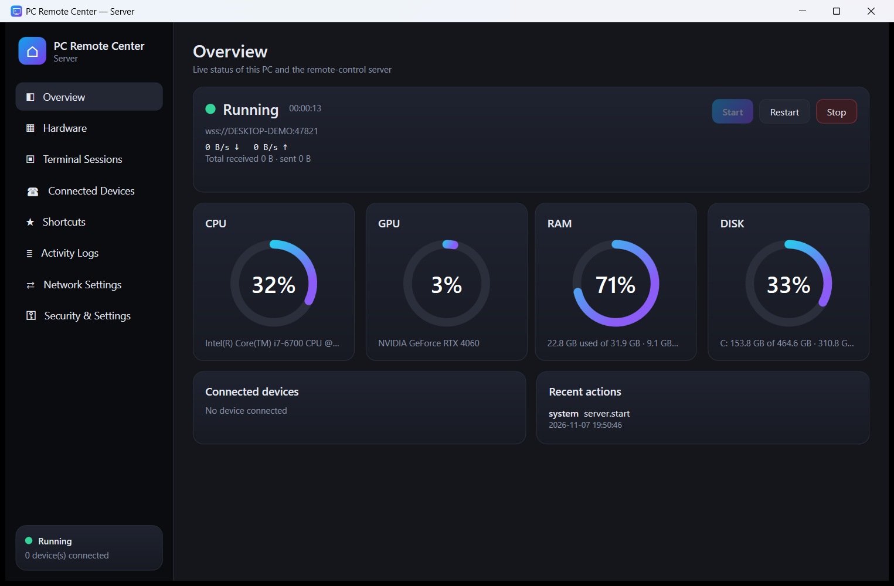
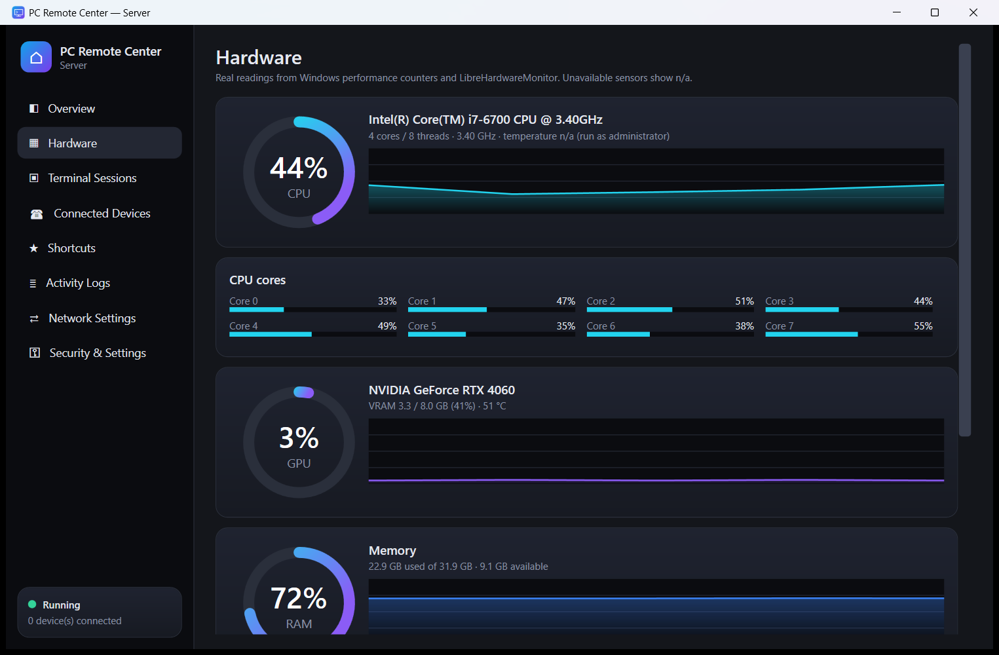
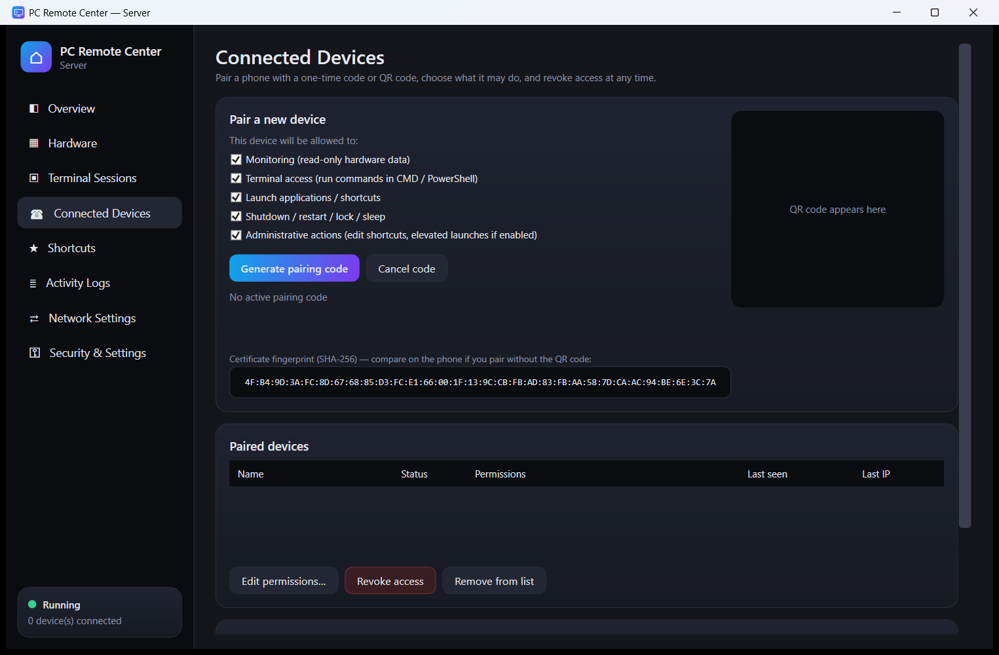
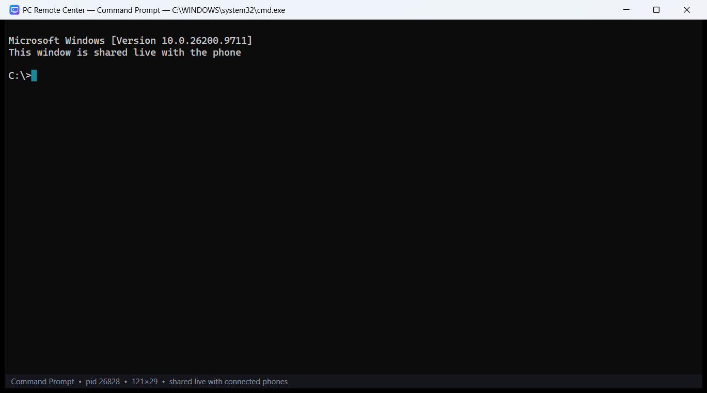

# PC Remote Center

Monitor and control your Windows PC from your Android phone – live hardware stats, two persistent terminals
(**CMD** and **PowerShell**), power actions, custom shortcuts and Wake-on-LAN – over an encrypted, authenticated
connection on your own network.

* **Windows server** – C# / .NET 10 / WPF, runs in your normal desktop session with a tray icon. Real ConPTY terminals whose
  windows are visible on the PC, ASP.NET Core TLS WebSocket server, SQLite storage.
* **Android app** – Kotlin / Jetpack Compose / Material 3, dark UI, QR pairing, LAN discovery, Keystore-protected credentials.
* **Nothing is mocked**: every number comes from Windows performance counters / LibreHardwareMonitor; sensors a PC does not
  expose show *n/a* instead of an invented value.

## Screenshots

| Overview | Hardware |
|---|---|
|  |  |
| **Pairing (one-time code + QR)** | **Terminal window on the PC** (the same ConPTY session the phone controls) |
|  |  |

*Screenshots of the Windows server taken with neutral demo data (computer name, addresses and user name are placeholders).
Android screenshots will be added once the app has been checked on a physical phone.*

## Status

**v1.1.0 is a pre-release.**

* Windows server: **83 automated tests pass on real Windows hardware** (hardware sensors, real CMD/PowerShell sessions, TLS,
  pairing, revocation, power confirmation, shortcut validation, restart recovery, backup/restore). Not covered by automatic
  tests: lock, sleep, the firewall button (needs UAC), Wake-on-LAN, tray notifications.
* Android app: builds, 56 JVM unit tests pass (protocol, terminal buffer, TLS pinning, QR parsing, Wake-on-LAN packet…).
  **It has not yet been exercised end-to-end against the server on a physical device** – please report problems via Issues.
* The binaries are not code-signed (Windows SmartScreen will warn); the APK attached to the release is a *debug-signed* build.

> ⚠️ A device with the *terminal* permission can run anything your Windows account can. Read [`Documentation/SECURITY.md`](Documentation/SECURITY.md).

## Features

| | |
|---|---|
| **Dashboard** | CPU (total, per-core, clock, temperature*), GPU (load, VRAM, temperature*), RAM, disks (usage, read/write speed, temperature*), animated gauges, history charts, warning thresholds |
| **Terminals** | Persistent CMD + PowerShell (ConPTY). Commands run in the *existing* shell, keep their working directory, variables and history, stream output live, support Ctrl+C, clear, resize, interactive programs. Split or full-screen view on the phone; the same sessions are visible in terminal windows on the PC |
| **System actions** | Restart / shutdown / sleep with server-enforced confirmation and countdown, cancel pending action, lock PC, Wake-on-LAN |
| **Shortcuts** | Add, edit, reorder, delete shortcuts (Task Manager, Device Manager, Services, Event Viewer, Network Connections, Resource Monitor, Settings, browsers, VS Code …) – validated, never run through a shell |
| **Security** | TLS with certificate pinning, one-time pairing codes + QR, hashed device tokens, per-device permissions, rate-limiting, LAN-only default, audit log, device revocation, no silent elevation |
| **Remote access** | Tailscale and WireGuard aware: the server detects the adapters, shows their addresses, can accept connections arriving through them (opt-in, bound to the VPN adapter), puts them in the pairing QR; the app remembers the addresses and shows which path it uses. See [`NETWORKING.md`](Documentation/NETWORKING.md) |
| **Reliability** | Heartbeat, automatic reconnect, session expiry, server restart recovery, duplicate-request protection, message size limits, crash logging |

\* temperature sensors need the server to be started as administrator; the server never elevates itself.

## Install

Download the latest installer, portable zip and APK from **[Releases](https://github.com/unupunct/PC-Remote-Center/releases)**
and follow [`Documentation/INSTALLATION.md`](Documentation/INSTALLATION.md):

1. Install the Windows server (`PCRemoteCenter-Server-Setup-<version>.exe`, no admin rights needed) and allow it through the firewall from *Network Settings*.
2. Install the APK on your phone.
3. PC: *Connected Devices → Generate pairing code*. Phone: *Add PC → Scan QR*.

## Repository layout

```
WindowsServer/        .NET solution: RemoteControlServer (WPF), RemoteControlServer.Core (all logic), Tests
AndroidClient/        Android app (Kotlin, Compose)
SharedProtocol/       protocol-spec.md + message-examples.json
Documentation/        INSTALLATION, SECURITY, NETWORKING, TROUBLESHOOTING
Installer/            Inno Setup script
Scripts/              build-windows.ps1, build-android.ps1, package-release.ps1, helpers
```

## Build

See *Building from source* in [`Documentation/INSTALLATION.md`](Documentation/INSTALLATION.md).

```powershell
pwsh -File Scripts\build-windows.ps1     # tests + self-contained publish -> dist\server
pwsh -File Scripts\build-android.ps1     # APK
pwsh -File Scripts\package-release.ps1   # installer + zip + APK + checksums -> dist\release
```

## License

[MIT](LICENSE)
